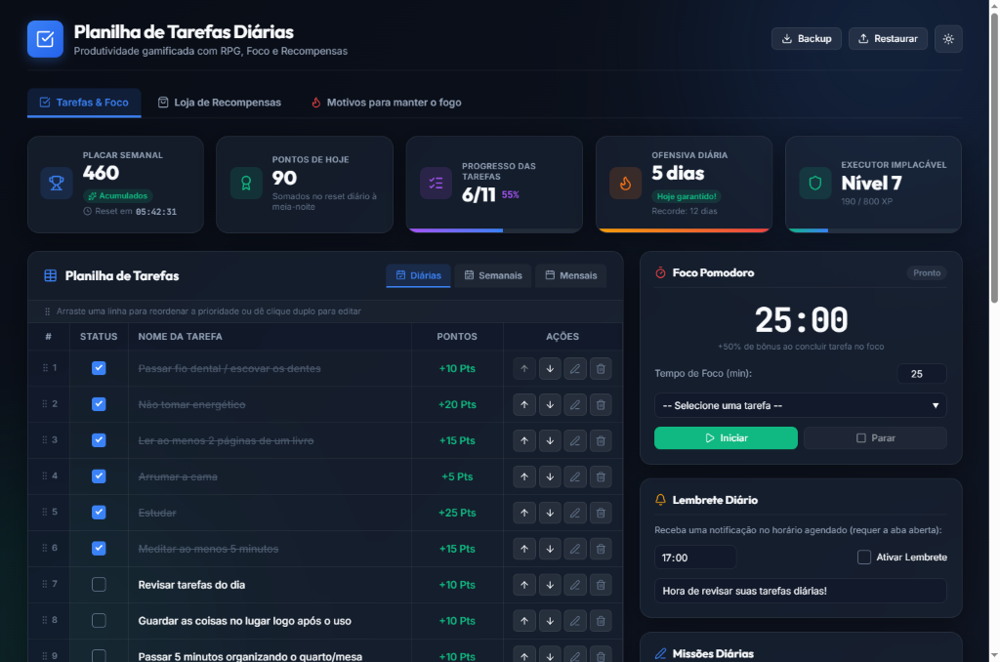
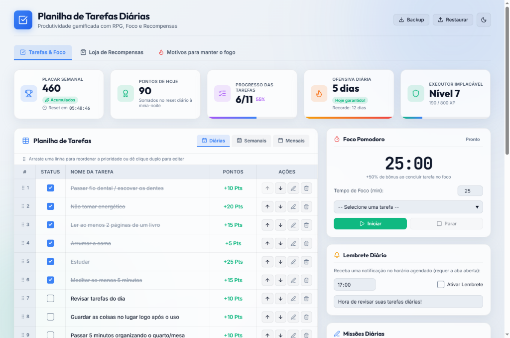

# Planilha de Tarefas Diárias — Produtividade Gamificada

[](https://samuelafs333.github.io/Planilha-Di-ria-de-Taregas/)
[](./manifest.json)
[](#estrutura-do-projeto)

> **Acesse o aplicativo online:** https://samuelafs333.github.io/Planilha-Di-ria-de-Taregas/

Um gerenciador de hábitos e tarefas pessoais gamificado, construído em **HTML, CSS e JavaScript puros (sem build)**, com **RPG de Produtividade**, **Ofensiva Diária (Streak)**, **Cronômetro Pomodoro**, **Loja de Recompensas**, **Gráficos de Evolução**, **Backup em JSON** e suporte completo a **PWA (instalável e offline)**.

---

## Prévia da Interface

### Tema Escuro (Padrão)


### Tema Claro


---

## Principais Funcionalidades

- **Planilha de Tarefas (Diárias, Semanais e Mensais)**:
  - Checkboxes interativas com pontuação personalizada por tarefa.
  - **Drag & Drop** (arrastar e soltar) e botões de mover cima/baixo para ordenar prioridades.
  - Edição rápida inline (clique duplo no nome ou botão editar, salvando com `Enter` e cancelando com `Esc`).
  - **Resets automáticos** na virada do dia, da semana (domingo) e do mês, contabilizando os pontos no histórico e convertendo-os em Moedas de Ouro.
- **RPG de Produtividade**:
  - Sistema de **XP, Níveis e Títulos** desbloqueáveis conforme você acumula pontos e ofensivas.
- **Sistema de Ofensiva Diária (Streak 🔥)**:
  - Acompanha quantos dias seguidos você bateu pelo menos **50%** das tarefas diárias, registra seu recorde e concede bônus diário de **Ouro e XP** (escalando a cada 7 dias seguidos).
- **Tarefa Bônus Especial**:
  - Defina um desafio extra para o dia com pontuação customizada (expira automaticamente à meia-noite).
- **Foco Pomodoro (+50% Bônus)**:
  - Temporizador configurável com vínculo direto a uma tarefa diária. Concluir uma tarefa pelo ciclo de foco garante **1.5x pontos**, além de alertas sonoros e notificações nativas.
- **Lembrete Diário & Missões Diárias**:
  - Alarme configurável por horário e bloco de notas rápido que transforma linhas em checklist de missões do dia.
- **Histórico de Evolução com Gráfico Interativo**:
  - Gráfico SVG responsivo (com alternância entre visão **Semanal** e **Mensal**) + tabelas detalhadas de semanas e meses anteriores.
- **Loja de Recompensas**:
  - Converta seus pontos em **Moedas de Ouro** e resgate momentos de lazer sem culpa. Crie, edite, reordene e acompanhe o histórico de resgates.
- **Motivos para Manter o Fogo**:
  - Galeria visual de propósitos e lista editável de motivações pessoais.
- **Backup & Restauração (JSON)**:
  - Botões no cabeçalho para exportar todos os dados (`localStorage`) em um arquivo `.json` e restaurá-los em qualquer navegador ou celular.
- **PWA Instalável e Offline**:
  - `manifest.json`, ícones dedicados e Service Worker (`sw.js`) com cache para funcionar mesmo sem internet e ser instalado na tela inicial do celular/PC.
- **UX Moderna**:
  - Notificações **Toast** e **Modais customizados** (sem `alert()`/`confirm()` nativos), confetes e alternância instantânea entre tema escuro e claro.

---

## Estrutura do Projeto

```text
planilha-tarefas-diarias/
├── index.html             # Interface semântica e tags PWA
├── styles.css             # Design system (Dark/Light + responsivo)
├── manifest.json          # Manifesto PWA instalável
├── sw.js                  # Service Worker (cache offline + notificações)
├── motivo1.jpg            # Foto 1 da galeria de motivação
├── motivo2.jpg            # Foto 2 da galeria de motivação
├── assets/
│   ├── icon.svg           # Ícone vetorial / favicon
│   ├── icon-192.png       # Ícone PWA 192x192
│   ├── icon-512.png       # Ícone PWA 512x512
│   ├── preview-dark.png   # Screenshot tema escuro
│   └── preview-light.png  # Screenshot tema claro
└── js/
    ├── state.js           # Estado, LocalStorage, resets automáticos e Backup JSON
    ├── ui.js              # Toasts, modal customizado, tema, abas, som e confetes
    ├── rpg.js             # Níveis RPG, Ofensiva (Streak) e atualização do dashboard
    ├── tasks.js           # Planilha (Drag & Drop), Tarefa Bônus e Missões Diárias
    ├── pomodoro.js        # Cronômetro Pomodoro e bônus de foco
    ├── shop.js            # Loja de Recompensas e histórico de resgates
    ├── history.js         # Gráfico SVG de evolução e tabelas semanais/mensais
    ├── motivation.js      # Lista de motivações pessoais
    └── main.js            # Inicialização, relógio de reset, lembrete e PWA
```

---

## Como Executar Localmente

1. **Abertura direta**: dê um duplo clique em `index.html` para abrir no navegador.
2. **Servidor local (recomendado para testar PWA/Service Worker)**:
   ```bash
   python -m http.server 8000
   ```
   Depois acesse `http://localhost:8000`.

---

## Publicação no GitHub Pages

1. Suba os arquivos atualizados para a branch principal (`main`) do repositório no GitHub.
2. No repositório, acesse **Settings → Pages**.
3. Em **Build and deployment**, selecione **Deploy from a branch**, escolha a branch `main` e a pasta `/ (root)`, e clique em **Save**.
4. Em cerca de 1 minuto o aplicativo estará publicado em:
   `https://samuelafs333.github.io/Planilha-Di-ria-de-Taregas/`
